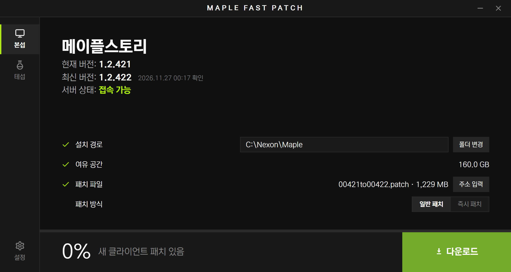
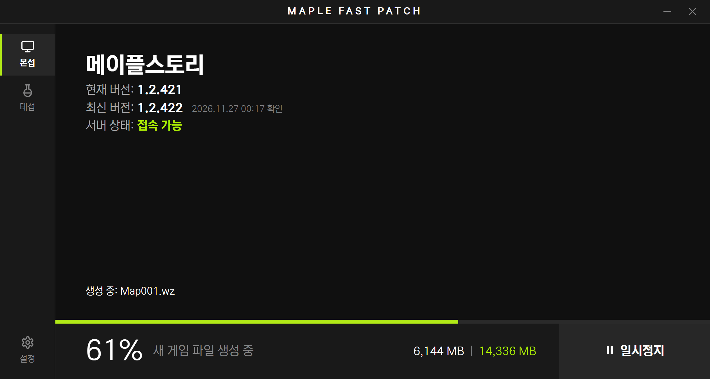

# Maple Fast Patch

메이플스토리(KMS) 점검 중에 패치 파일을 미리 적용해 점검이 끝나면 게임을 시작할 수 있도록 준비하는 Windows용 데스크톱 애플리케이션입니다.

  

  

> 넥슨의 제작이나 승인을 거치지 않은 비공식 프로그램입니다.
> 메이플스토리와 넥슨은 넥슨코리아의 상표이며, 사용에 따른 책임은 사용자에게 있습니다.

## 주요 기능

- **패치 확인·적용**: 설치 폴더·버전 자동 감지, 새 패치 확인 및 버튼 한 번으로 다운로드·적용
- **이어하기**: 일시 정지한 패치를 앱 재실행 후에도 재개
- **일반 패치·즉시 패치**: 모든 새 파일 생성·검증 후 교체 및 적용 실패·중단 시 복구 시도(일반)와 여유 공간 절약(즉시) 중 선택
- **점검 상태 알림**: 서버 점검 시작·연장·종료 시 알림 발송
- **자동 패치**: 주기적 확인 후 최신 패치 자동 진행
- **패치 후 게임 자동 실행**: 본섭 패치 완료 및 접속 가능 확인 시 게임 자동 실행
- **본섭·테섭**: 서버별 관리 및 테섭 첫 패치 수동 시작
- **오래된 버전 지원**: 여러 버전 뒤처진 클라이언트도 최신 버전까지 패치

## 다운로드

- **설치 파일**: 공개 후 [GitHub Releases](https://github.com/Kimhasa/maple-fast-patch/releases)에서 다운로드
- **지원 환경**: Windows 10(64비트) 이상
- **코드 서명**: 서명 없음, ‘Windows의 PC 보호’가 표시되면 ‘추가 정보’ → ‘실행’

## 알아 둘 것

- **설치 드라이브 여유 공간**: 다운로드 파일이 작아도 본 패치의 새 파일 생성에 수십 GB가 필요할 수 있음, 공간 부족 시 게임 파일 교체 전 중단
- **즉시 패치**: NTFS 드라이브에서만 시작. 게임 파일 교체 시작 후 중단 시 이전 버전 복구 불가, 같은 패치로 이어하기 필수

## 버그 제보

- **오픈카톡**: [open.kakao.com/o/sERUmQYi](https://open.kakao.com/o/sERUmQYi)
- **GitHub**: [Issues](https://github.com/Kimhasa/maple-fast-patch/issues)

## 라이선스

[MIT License](LICENSE). Copyright (c) 2026 Maple Fast Patch contributors
